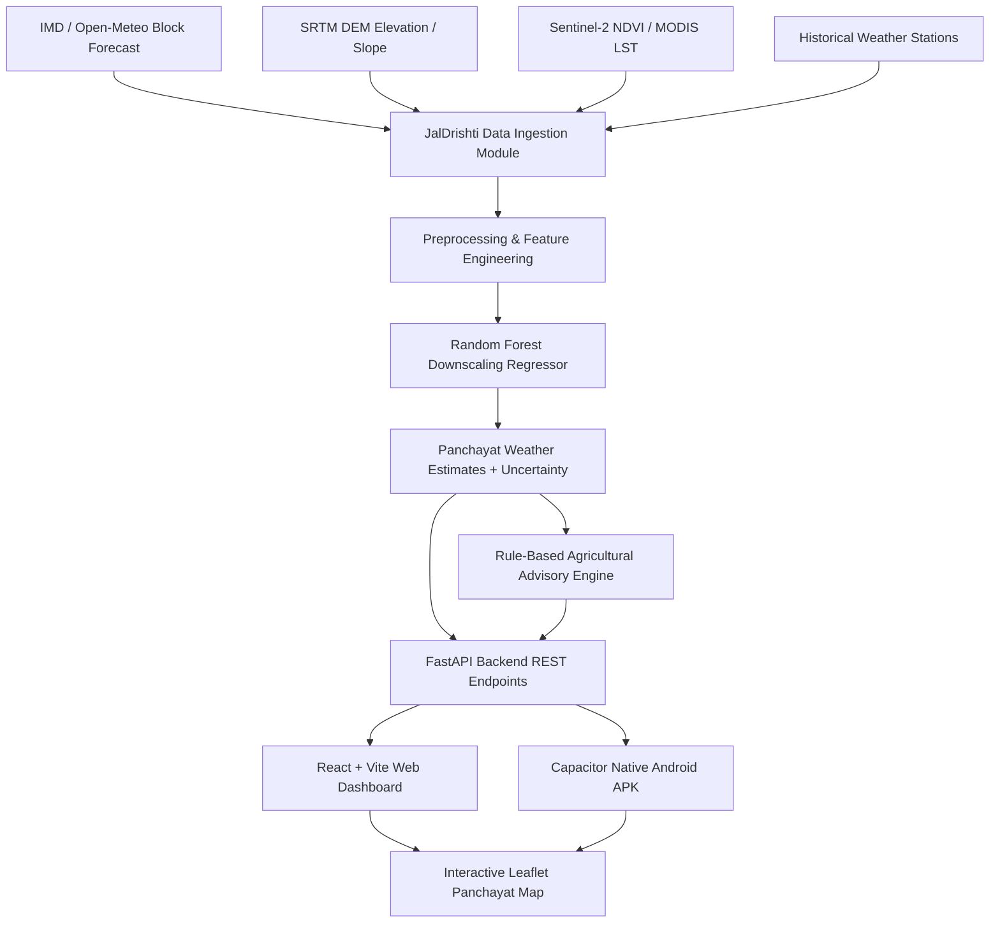

# JalDrishti: AI-Powered Weather Forecast Downscaling & Android Application

[](https://sih.gov.in/)
[](https://fastapi.tiangolo.com/)
[](https://vitejs.dev/)
[](https://capacitorjs.com/)
[](https://scikit-learn.org/)

**JalDrishti** (*Jal* = Water/Climate, *Drishti* = Vision/Insight) is a full-stack web and native Android application built for the **Smart India Hackathon (SIH)** to downscale coarse, block-level meteorological forecasts (25km × 25km grid) into hyper-local Panchayat-level weather estimates and crop-specific agricultural advisories.

---

## 1. Problem Background & Solution

### The Challenge
Current numerical weather prediction (NWP) models and IMD forecasts operate at district or block levels. However:
- A single block spans diverse micro-climates, elevations, slopes, and vegetation densities.
- Farmers in hill-slope Panchayats receive identical rain forecasts as valley Panchayats, leading to inaccurate irrigation, spraying, and harvesting schedules.
- Coarse forecasts do not capture micro-scale heat waves or sudden localized showers.

### The JalDrishti Solution
JalDrishti combines machine learning regressors (Random Forest & XGBoost) with geospatial terrain features (SRTM Elevation, Slope, Aspect), satellite indices (Sentinel-2 NDVI, MODIS LST), and historical station observations to:
1. **Downscale** block-level rainfall (mm), max/min temperature (°C), humidity (%), and wind speed (km/h).
2. **Generate Crop Advisories** tailored to specific growth stages (Wheat, Paddy, Maize, Mustard, Tomato).
3. **Display Interactive GIS Maps** with Panchayat boundary overlays and spatial weather gradients.
4. **Offer Multilingual Support** (English & Hindi) for accessible farmer communication.
5. **Run as a Native Android Application** packaged via Capacitor.

---

## 2. System Architecture & Workflow



---

## 3. Technology Stack

- **Mobile App**: Capacitor 6, Android SDK (Target API 35 / Min API 22), Java 21 OpenJDK.
- **Web Frontend**: React 18, Vite, TypeScript, Tailwind CSS, Recharts, Leaflet & React-Leaflet, Lucide React, Axios.
- **Backend**: Python 3.10+, FastAPI, Pydantic v2, SQLAlchemy, SQLite (Development) / PostGIS (Production).
- **AI/ML**: Scikit-Learn, Pandas, NumPy, Joblib, GeoPandas, Shapely.
- **Containerization & Deployment**: Docker, Docker Compose, Vercel (Web), Render / Railway (Backend).

---

## 4. Location Hierarchy & Supported States

JalDrishti supports a 4-level administrative hierarchy: **State → District → Block → Gram Panchayat**.

### Currently Included States & Administrative Units:
- **Himachal Pradesh**: Solan (Dharampur: Khedpur, Subathu Valley, Garkhal Ridge), Shimla (Theog: Fagu)
- **Chhattisgarh**: Raipur (Dharsiwa: Sankra, Sejbahar), Bastar (Jagdalpur: Tekameta)
- **Maharashtra**: Pune (Haveli: Wagholi, Uttamnagar), Nashik (Niphad: Pimpalgaon Baswant)
- **Madhya Pradesh**: Indore (Depalpur: Gautampura), Ujjain (Badnagar: Sundarabad)
- **Uttar Pradesh**: Rampur (Rampur: Bishanpur, Milak Rural), Varanasi (Kashi Vidyapeeth: Shivpur)
- **Bihar**: Patna (Sampatchak: Kanchanpur), Gaya (Bodhgaya: Mastipur)
- **Rajasthan**: Jaipur (Amber: Achrol), Jodhpur (Luni: Salawas)
- **Gujarat**: Patan (Patan: Chandur, Saraswati Nagar)

*Note: The dataset is extensible. Official government LGD (Local Government Directory) Shapefiles or GeoJSON boundaries can be imported directly into `backend/data/sample/sample_panchayats.json` and `backend/data/boundaries/panchayat_boundaries.geojson`.*

---

## 5. Repository Structure

```
JalDrishti/
├── backend/
│   ├── app/
│   │   ├── api/          # FastAPI endpoints (health, locations, weather, advisories, map, model, feedback)
│   │   ├── database/     # SQLAlchemy models & connection
│   │   ├── schemas/      # Pydantic schemas
│   │   ├── services/     # Weather, location, advisory & data services
│   │   └── main.py       # FastAPI application
│   ├── ml/
│   │   ├── feature_engineering/ # Lapse rate, NDVI, LST, slope builder
│   │   ├── training/          # Train models script
│   │   ├── evaluation/        # Evaluator (MAE, RMSE, R2, Rain F1)
│   │   ├── inference/         # WeatherDownscalerPredictor engine
│   │   └── trained_models.joblib # Trained Random Forest artifact
│   ├── data/
│   │   ├── sample/       # Sample forecasts, historical paired observations, crops
│   │   └── boundaries/   # Panchayat GeoJSON boundaries
│   ├── tests/            # API integration tests
│   └── requirements.txt
├── frontend/
│   ├── src/
│   │   ├── components/   # Navbar, LocationSelector, ForecastCard, PanchayatMap, WeatherChart, AdvisoryCard
│   │   ├── pages/        # LandingPage, DashboardPage, PanchayatDetailsPage, AdvisoryCentrePage, ModelPerformancePage, DataInfoPage, FeedbackPage
│   │   ├── i18n/         # English & Hindi translation dictionaries
│   │   ├── services/     # API Client with configurable VITE_API_BASE_URL
│   │   └── App.tsx
│   ├── android/          # Native Android Studio Capacitor Project
│   │   └── app/build/outputs/apk/debug/app-debug.apk
│   ├── capacitor.config.ts
│   ├── package.json
│   └── vite.config.ts
├── Dockerfile
├── docker-compose.yml
├── .env.example
├── .gitignore
└── README.md
```

---

## 6. Development & Build Setup

### Backend Setup
```bash
# Activate virtual environment
python -m venv env
.\env\Scripts\activate

# Install requirements
pip install -r backend/requirements.txt

# Train ML downscaling models
python -m backend.ml.training.train_models

# Start FastAPI server
python -m uvicorn backend.app.main:app --reload --port 8000
```

### Web Frontend Setup
```bash
cd frontend
npm install
npm run dev
```

### Android APK Build Steps
```bash
cd frontend

# 1. Build frontend bundle
npm run build

# 2. Sync native Android project
npx cap sync android

# 3. Build Debug APK using Gradle
cd android
powershell -Command "$env:JAVA_HOME='C:\Program Files\Android\Android Studio\jbr'; $env:ANDROID_HOME='C:\Users\HP\AppData\Local\Android\Sdk'; .\gradlew.bat assembleDebug"
```

**Output Debug APK Path**:
`frontend/android/app/build/outputs/apk/debug/app-debug.apk`

---

## 7. Remote Backend Deployment & Release APK

To distribute the Android APK to farmers or judges:
1. Deploy the FastAPI backend to a publicly accessible HTTPS host (e.g. Render, Railway, AWS EC2 with SSL).
2. Set the frontend environment variable:
   ```bash
   VITE_API_BASE_URL=https://jaldrishti-api.onrender.com/api
   ```
3. Build release APK:
   ```bash
   cd frontend/android
   .\gradlew.bat assembleRelease
   ```
4. Sign the APK using `keytool` and `apksigner`.

---

## 8. API Documentation

| Method | Endpoint | Description |
| :--- | :--- | :--- |
| `GET` | `/api/health` | Backend and ML model health check |
| `GET` | `/api/locations/states` | List states |
| `GET` | `/api/locations/districts?state=Chhattisgarh` | List districts in state |
| `GET` | `/api/locations/blocks?state=Chhattisgarh&district=Raipur` | List blocks in district |
| `GET` | `/api/locations/panchayats?block=BLK_DHR_CG` | List Panchayats in block |
| `GET` | `/api/weather/panchayat/{id}` | Get 5-day downscaled weather forecast |
| `GET` | `/api/advisories/{id}?crop=Paddy` | Get stage & weather crop advisories |
| `GET` | `/api/map/panchayats` | Get GeoJSON boundaries with forecast attributes |
| `GET` | `/api/model/metrics` | Model accuracy & evaluation metrics |
| `POST` | `/api/feedback` | Submit farmer observations |

---

## 9. Verification & Test Results

- **Backend API Unit Tests**: Passed (`python -c "import backend.tests.test_api as t; ..."`).
- **Multi-State Hierarchy & Weather Tests**: Passed (`Chhattisgarh`, `Maharashtra`, `Madhya Pradesh`, `Uttar Pradesh`, `Bihar`, `Rajasthan`, `Gujarat`).
- **Web App Build**: `npm run build` compiled cleanly in 10.5s.
- **Android APK Build**: `gradlew assembleDebug` generated `app-debug.apk` in 4m 31s.

---

## 10. Acknowledgments

**Smart India Hackathon 2025 Submission - Team JalDrishti**
*Localized Panchayat-level weather forecasting and agricultural decision support for Indian farmers.*
